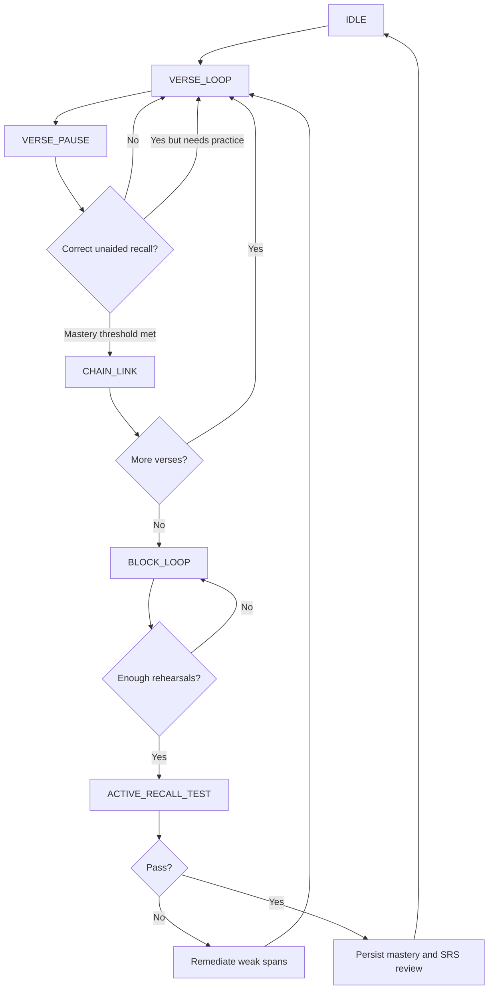

# Zen Hifz — Comprehensive Quran Memorization Research & Audio Architecture

**Version:** 1.0  
**Prepared:** 2026-11-02  
**Scope:** Traditional Hifz pedagogy, cognitive science, mastery-state machine, revision algorithm, per-ayah CDNs, reciter/riwayah metadata, Flutter/React integration, release criteria.  
**Related machine-readable catalog:** `zen_hifz_reciters.json` (24 records)

> **Important evidence and verification note:** This document converts the previously developed research report into an engineering specification. Claims about specific URLs are based on publicly listed provider folders and representative example assets, **not** comprehensive live audits of every file, recording, codec, audio authenticity, license, or geographical availability. The repetition formulas and review intervals are product heuristics, not proven religious or scientific optima. A teacher should validate Quranic rules, Quranic text variants, tajwid assessment, and the separation of riwayah/tariq.

## Executive decision

Build a **mastery-based Hifz engine**, not a fixed-count MP3 repeater. A session must include **modeled listening**, **self-recitation**, **verse-to-verse linking**, **complete block rehearsal**, **independent recall**, and **scheduled long-term revision**. Keep the engine separate from both Quran-content identity and media-source selection.

**Canonical sequence:** `Listen → Recite → Verify → Link → Consolidate → Test unaided → Schedule review`.

### Product principles

1. Minimum repetition targets are **practice exposure**, not evidence of memorization.
2. Learners only graduate a verse/block following a verified unaided recall criterion.
3. Maintain distinct results for word accuracy, sequence continuity, tajwid, fluency/hesitation and assistance required.
4. Make text, audio, timing and recitation metadata agree on **riwayah**, and if applicable, **tariq**.
5. Allow manual grading and qualified-teacher correction; do not mistake speech detection for Quranic accuracy.
6. Keep initial architecture offline-friendly and distraction-free.

---

# 1. Pedagogical research

## 1.1 Traditional schools compared

| Tradition | Typical practice | Strength for the app | Limitation/qualification |
|---|---|---|---|
| Mauritanian / Shinqiti (شنقيطي) | Tablet/lawh writing, oral repetition, teacher correction, memorization before erasure | Strong independent recall, exactness and progression gates | Repetition numbers vary by teacher and student; avoid universal folklore numbers |
| Turkish/Ottoman cyclic | Recurrent rotation through juz; well-described scheme starts with the last page of each juz, then earlier pages on later cycles | Structured cross-Quran revision and stable page-goals | Not a universal format; potentially confusing for novice learners |
| Multi-tier daily Hifz | New material + chain-linking + recent review + distant review | Prevents new memorization from crowding out previous material | Requires time allocation and backlog management |
| Spaced retrieval | Successful recall at increasingly distant intervals | Better long-term retention than massed exposure alone | Interval selection must be adaptive and sequencing-aware |

### Shinqiti Digital Lawh (اللوح الرقمي)

A digital reinterpretation, not a claim to replace a teacher:

1. Show the selected verse on a clean, legible mushaf view.
2. Play a verified reciter while the learner follows visually.
3. Invite spoken recitation after a gap; replay as necessary.
4. Mask the text progressively, then completely.
5. Have the learner independently recall the ayah and its immediate neighbors.
6. Verify errors, correct them and repeat the weak span.
7. Add passed material to the review queue, analogous to completing and erasing a lawḥ.

Recommended UX: explicit **Show text**, **Hide text**, **Hear once**, **Recite now**, **Mark difficulty**, **Repeat difficult phrase**. Show a quality indicator, not a distracting streak counter.

### Turkish/Ottoman cyclic mode

Offer as an optional curriculum overlay:

- A documented approach progresses through the final page of each of the 30 juz before expanding earlier page coverage on subsequent cycles.
- Use stable page identifiers from a particular mushaf edition; page numbers are **edition-dependent**.
- Separate `curriculumSequence` from `memorizationState`: the former chooses what to study, the latter measures mastery.
- Review material already learned before moving ahead in the cycle.

### Double-tier/four-queue scheduling

Maintain explicit queues:

| Queue | Arabic | Task |
|---|---|---|
| New acquisition | الحفظ الجديد | First memorization of new ayahs |
| Chain linking | الربط التراكمي | Recitation across verse boundaries |
| Recent revision | المراجعة القريبة | Recently learned material (days) |
| Distant revision | المراجعة البعيدة | Older, better-established material (weeks/months) |

**Initial proposed time split** (not research-derived optimum): 30% new, 15% linking, 25% recent, 30% distant. Shift time away from new content when missed reviews accumulate. Preserve daily review time as a first-class budget constraint.

## 1.2 Evidence from learning science

### Spacing and retrieval practice

Reviews of learning techniques identify distributed practice and practice testing as broadly useful. Retrieval practice requires producing information from memory, rather than just recognizing it while listening. Evidence supports the **direction** of this design choice; it does **not** specify a scientifically optimal count of Quran recitations.

### Cognitive load and chunking

- For short verses, an ayah often forms a natural rehearsal unit.
- For long ayahs, segment only at **approved recitational/meaningful boundaries**. Do not automatically split on N characters or fixed seconds.
- Allow mastery of sub-ayah segments before joining them into the full verse.
- Mutashabihat (similar passages) require **contrastive practice**: show relevant context and distinguish words, then test without prompts.

### Silent self-recitation gap (مهلة الترديد الذاتي)

The gap matters because it creates an opportunity to **retrieve**, not because silence itself has a magic duration. Prefer a gap based on recorded ayah length, with an **End attempt** control and optional voice-activity detection; the latter tells you speech happened, not that it was correct.

**Listening / independent recitation ratio:** no defensible universal 1:1 or 1:3 optimum was established. Start with one listening pass followed by one learner attempt, then progressively reduce audio as recall becomes strong. Track actual assistance per successful retrieval.

### Tajwid and error taxonomy

Record at least: `omission`, `substitution`, `insertion`, `order_error`, `transition_error`, `tashkil_or_vowel_error`, `tajwid_error`, `hesitation`, `prompt_required`. Do not claim automatic correction is equivalent to teacher assessment. Prioritize reattempts on the **exact failure location plus its prior/next context**.

---

# 2. Formal Golden Loop algorithm

## 2.1 Definitions and planning parameters

Let a study block contain `K` ayahs, `[a1, ..., aK]`:

- `d ∈ {1,2,3,4,5}`: learner-assessed difficulty.
- `T`: session budget in minutes.
- `t_i`: known audio duration in seconds for ayah `i`.
- `clip(x, lo, hi) = min(hi, max(lo, x))`.

**Recommended *initial heuristic*, subject to experimentation:**

```text
L_i = clip(ceil(log2(t_i / 12)), 0, 3)
N_i = clip(2 + d + L_i, 3, 10)           // guided verse attempts
M   = clip(ceil(K / 4) + ceil(d / 2), 2, 8) // block rehearsals
G_i = clip(1.25 * t_i + 2 * (d - 1), 8, 120) // pause window (seconds)
```

Notes:
- `N_i` is the minimum guided exposure goal; independent recall is still required.
- `M` counts planned consolidation rehearsals. Some or all later runs should be **without** audio.
- The `G_i` window can end sooner when the learner finishes, or be extended if needed.
- Use audio duration to approximate difficulty; integrate measured errors/hesitations over time.
- Do **not** reduce mastery criteria merely to fit a chosen session duration.

Approximate time needed for a candidate block:

```text
T_estimated_minutes = (
    Σ_i [N_i * (t_i + G_i)]
    + (M + 1) * Σ_i t_i
    + T_link_seconds
) / 60

Initial rough estimate: T_link_seconds ≈ 0.6 * K * mean(t_i)
```

This estimate is optimistic: it may omit microphone startup, feedback, correction passes, unexpected pauses, and scheduled reviews. Instrument actual times, compute percentiles per learner, and choose the largest block fitting acquisition time.

## 2.2 Phase specification

### Phase A — Individual verse mastery (آية بآية)

1. Confirm the verse belongs to the chosen riwayah/tariq and validated mushaf text.
2. Optionally play one model recitation while showing text.
3. Enter `VERSE_PAUSE`: stop audio; invite learner recitation.
4. Record independently graded result and errors.
5. Continue until `attempts ≥ N_i` **and** two consecutive successful unaided attempts (configurable). Cap attempts and save partial progress to prevent frustration.
6. For long verses, repeat on teacher-validated segments and require a final full-ayah test.

### Phase B — Cumulative chain linking (الربط التراكمي)

Practice `[a1,a2]`, then `[a1,a2,a3]`, etc. For long blocks, use an expanding window to reduce exponential workload (`last 2–4 ayahs` plus periodic full chain). Grade transitions separately because a learner may know each verse but fail at the next start.

### Phase C — Full block consolidation (تثبيت المقطع)

Perform `M` rehearsals. Example support sequence: `full audio` first, then `first-word cue`, then `no audio`. The final rehearsal should approximate independent continuous recitation. Avoid artificial MP3 silence that hides phoneme boundaries.

### Phase D — Active recall test (التسميع)

Mask words and remove audio. The learner recites the block with optional local recording. Teacher/self-assessment or validated voice models supply graded performance. Pass only after meeting defined thresholds; otherwise route failed spans back to targeted practice. Persist result and create spaced-review tasks.

## 2.3 States and transitions

Required states: `IDLE`, `VERSE_LOOP`, `VERSE_PAUSE`, `CHAIN_LINK`, `BLOCK_LOOP`, `ACTIVE_RECALL_TEST`.



Supporting non-pedagogical runtime substates should include `BUFFERING`, `PAUSED_BY_USER`, `OFFLINE`, `ERROR_RECOVERABLE`, and `SESSION_SUSPENDED`. They should not be confused with learning stages.

## 2.4 Reference pseudocode (TypeScript-like)

```ts
type State =
  | 'IDLE' | 'VERSE_LOOP' | 'VERSE_PAUSE'
  | 'CHAIN_LINK' | 'BLOCK_LOOP' | 'ACTIVE_RECALL_TEST';

async function runGoldenLoop(session: HifzSession) {
  let state: State = 'IDLE';
  for (let i = 0; i < session.verses.length; i++) {
    const verse = session.verses[i];
    const minimum = repetitionsFor(verse, session.difficulty);
    let attempts = 0;
    let consecutiveRecalls = 0;

    while (attempts < minimum || consecutiveRecalls < 2) {
      state = 'VERSE_LOOP';
      await playVerse(verse);
      attempts++;
      state = 'VERSE_PAUSE';
      const result = await assessLearnerRecitation({
        verse,
        maxSeconds: pauseWindow(verse, session.difficulty),
        textVisible: false,
      });
      if (result.correctWithoutPrompt) consecutiveRecalls++;
      else {
        consecutiveRecalls = 0;
        await showTargetedCorrection(result);
      }
      if (attempts >= session.maxVerseAttempts)
        return saveIncomplete(session, verse);
    }

    state = 'CHAIN_LINK';
    const result = await testSequence(session.verses.slice(0, i + 1));
    if (!result.passed) await remediateTransitions(result.errors);
  }

  state = 'BLOCK_LOOP';
  const M = consolidationRepetitions(session);
  for (let k = 0; k < M; k++) {
    await practiceBlock(session.verses, {
      audioSupport: k === 0 ? 'full' : 'reduced',
    });
  }

  state = 'ACTIVE_RECALL_TEST';
  const assessment = await testWithoutTextOrAudio(session.verses);
  if (!assessment.passed) {
    await enqueueWeakSpans(assessment.errors);
    return saveIncomplete(session, assessment);
  }
  await updateSpacedReview(session.verses, assessment);
  state = 'IDLE';
  return { status: 'completed', state };
}
```

The pseudocode assumes an actual correctness signal supplied by manual grading, teacher review, or a validated Quran-specific assessment service. Do not infer correctness from audio playback success or presence of sound.

## 2.5 Review scheduler

**Starter interval ladder:** 20 minutes → 1 day → 3 days → 7 days → 14 days → 30 days → adaptive intervals. These are **tunable defaults**, not proven Quran-specific optimum intervals.

| Recall grade | Interpretation | Proposed behavior |
|---|---|---|
| 0–1 | Missed / required extensive help | Immediate remediation, same-day follow-up |
| 2 | Many hesitations or several errors | Short interval, weak-span focus |
| 3 | Partial success with minor errors | Maintain or modestly extend interval |
| 4 | Accurate unaided retrieval | Advance interval |
| 5 | Fluent accurate retrieval and transitions | Advance with confidence |

Store separate review targets for `verse`, `transition`, `verse_range`, and `mutashabihat_pair`. A sequence-memory system cannot rely exclusively on treating each ayah as an unrelated flashcard.

### Suggested persistence model

```json
{
  "learnerId": "user-id",
  "riwayah": "hafs",
  "tariq": null,
  "mushafEditionId": "verified-edition-id",
  "range": { "start": "2:1", "end": "2:5" },
  "reciterId": "husary_muallim",
  "stage": "ACTIVE_RECALL_TEST",
  "attempts": 6,
  "successfulUnaidedRecalls": 2,
  "scores": {
    "words": 0.98,
    "sequence": 1.0,
    "tajwid": null,
    "fluency": 0.85
  },
  "errors": [],
  "nextReviewAt": "2026-11-03T12:00:00Z",
  "gradingSource": "self_reported"
}
```

All timestamps should be persisted in UTC, displayed in the learner's local time zone. The sample above is illustrative, not an actual recorded event.

---

# 3. Audio CDN research and acquisition strategy

## 3.1 Provider comparison

| Provider | Per-ayah access | URL/access behavior | Role | Limitations |
|---|---|---|---|---|
| [EveryAyah](https://everyayah.com/data/) | Yes | Predictable static `{surah:03d}{ayah:03d}.mp3` within reciter folders | Preferred starting point for per-ayah repeats | Audit coverage, rights, actual codecs, missing ayahs |
| [Quran Foundation / Quran.com](https://api-docs.quran.com/docs/sdk/javascript/audio/) | Yes | Official audio metadata endpoint / returned verse URLs | Strong structured metadata adapter | Credential and API terms; IDs must use right type |
| [MP3Quran](https://mp3quran.net/api/v3/reciters?language=eng) | Primarily full-surah | Dynamic mushaf `server` + `{surah:03d}.mp3`; separate timings | Discovery, long-form and missing-riwayah fallback | Not a guaranteed public per-ayah MP3 pattern |
| VerseByVerse legacy / EveryAyah | Ayah-level files | Often effectively indexed through EveryAyah | Compatibility / lineage | Verify exact hosted resource, not an assumed independent provider |

### EveryAyah URL

```text
https://everyayah.com/data/{reciterFolder}/{surah:03d}{ayah:03d}.mp3
```

Examples:

- Hafs, Al-Husary Muallim, Al-Fatihah 1:1: https://everyayah.com/data/Husary_Muallim_128kbps/001001.mp3
- Hafs, Al-Minshawy Murattal, Al-Baqarah 2:255: https://everyayah.com/data/Minshawy_Murattal_128kbps/002255.mp3
- Warsh, Ibrahim Al-Dosary, Al-Fatihah 1:1: https://everyayah.com/data/warsh/warsh_ibrahim_aldosary_128kbps/001001.mp3

When `surah = 2, ayah = 255`, the basename is `002255.mp3`. Validate `ayah` against a trusted Quran chapter/verse mapping, rather than simply accepting any two integers.

### Quran Foundation API v4

The API's **ayah recitation ID** may differ from the **chapter-reciter ID**. A documented verse lookup route is:

```http
GET /content/api/v4/recitations/{recitation_id}/by_ayah/{verse_key}
```

Use official current SDK/API documentation for authentication, headers, fields and base host. Resolve real audio URLs from returned metadata; **do not invent** static folder naming for API outputs. Do not expose API credentials in web/mobile builds.

### MP3Quran API v3

```http
GET https://mp3quran.net/api/v3/reciters?language=eng
```

The returned reciter/mushaf metadata generally provides a `server` prefix for a chapter audio filename in the form `001.mp3` for Surah Al-Fatihah. Its published verse timings may enable accurate seeking **only where timing records correspond to that exact recitation**. Validate HTTP range requests and edge silences before treating a seek as a true ayah file.

## 3.2 Bitrate and qualitative suitability

The catalog's `bitrate` is the rate advertised in the folder name, **not** a measured stream rate. MP3 may be VBR; measure sampled file metadata with `ffprobe`. Tempo categories `slow`, `medium`, `fast` are editorial guidance rather than calculated phoneme/word-per-minute rates. Teacher/Muallim recordings often include instruction or repetition; verify actual content layout before combining them with an automatic loop.

**Hifz defaults:** Al-Husary Muallim or Murattal and Al-Minshawy Muallim are strong beginner candidates; Murattal Al-Minshawy, Al-Hudhaify, and Mishary Alafasy are viable general-use options; Mujawwad is often better for attentive listening or advanced work rather than short, time-boxed loops. This is a design judgment, not comparative-trial evidence.

## 3.3 Riwayah and tariq compatibility

- **Hafs 'an 'Asim (حفص عن عاصم):** Per-ayah static folders listed below.
- **Warsh 'an Nafi' (ورش عن نافع):** Three listed EveryAyah Warsh recording folders; **the precise tariq (Al-Azraq or Al-Asbahani) is not independently established** by folder naming. Represent as `warsh_unverified_tariq` and **do not** label the client as Azraq/Asbahani without confirmation.
- **Qalun 'an Nafi' (قالون عن نافع):** Al-Husary, Al-Hudhaify and Muhammad Al-Aalim Al-Dokali identified as recordings, but a stable direct ayah URL is **not verified**. Set `cdnPattern: null`. Do not offer as an enabled per-ayah playback choice until assets and rights are ready.
- **Al-Duri 'an Abi 'Amr (الدوري عن أبي عمرو):** Optional, excluded from shipping catalog because no adequately verified direct ayah endpoint was established.

**P0 rule:** Verse text, orthography, diacritics, stop marks, basmalah convention, reciter audio, search index and automated assessments must use the same approved riwayah/tariq + mushaf edition. Switching reciters must never silently switch recitation tradition.

## 3.4 Current reciter directory

The table lists all 24 entries in the JSON catalog. `N/A` means the URL is not verified; `bitrate` is nominal. Identifiers are stable internal suggestions, not globally recognized recitation IDs.

| ID | Arabic name | English name | Riwayah | Style | Tempo | Nominal kbps | Direct ayah pattern status | Recommended |
|---|---|---|---|---|---|---:|---|---|
| `husary_muallim` | محمود خليل الحصري | Mahmoud Khalil Al-Husary | `hafs` | muallim | slow | 128 | EveryAyah pattern listed | Yes |
| `husary_murattal` | محمود خليل الحصري | Mahmoud Khalil Al-Husary | `hafs` | murattal | slow | 128 | EveryAyah pattern listed | Yes |
| `husary_mujawwad` | محمود خليل الحصري | Mahmoud Khalil Al-Husary | `hafs` | mujawwad | slow | 128 | EveryAyah pattern listed | No |
| `minshawy_teacher` | محمد صديق المنشاوي | Muhammad Siddiq Al-Minshawy | `hafs` | muallim | slow | 128 | EveryAyah pattern listed | Yes |
| `minshawy_murattal` | محمد صديق المنشاوي | Muhammad Siddiq Al-Minshawy | `hafs` | murattal | slow | 128 | EveryAyah pattern listed | Yes |
| `minshawy_mujawwad` | محمد صديق المنشاوي | Muhammad Siddiq Al-Minshawy | `hafs` | mujawwad | slow | 192 | EveryAyah pattern listed | No |
| `abdulbasit_murattal` | عبد الباسط عبد الصمد | Abdul Basit Abdus Samad | `hafs` | murattal | medium | 192 | EveryAyah pattern listed | Yes |
| `abdulbasit_mujawwad` | عبد الباسط عبد الصمد | Abdul Basit Abdus Samad | `hafs` | mujawwad | slow | 128 | EveryAyah pattern listed | No |
| `alafasy` | مشاري راشد العفاسي | Mishary Rashid Alafasy | `hafs` | murattal | medium | 128 | EveryAyah pattern listed | Yes |
| `hudhaify_hafs` | علي بن عبد الرحمن الحذيفي | Ali Al-Hudhaify | `hafs` | murattal | slow | 128 | EveryAyah pattern listed | Yes |
| `ghamadi` | سعد الغامدي | Saad Al-Ghamdi | `hafs` | murattal | medium | 40 | EveryAyah pattern listed | Yes |
| `ayyub` | محمد أيوب | Muhammad Ayyub | `hafs` | murattal | medium | 128 | EveryAyah pattern listed | Yes |
| `shatri` | أبو بكر الشاطري | Abu Bakr Al-Shatri | `hafs` | murattal | medium | 128 | EveryAyah pattern listed | Yes |
| `shuraim` | سعود الشريم | Saud Al-Shuraim | `hafs` | murattal | fast | 128 | EveryAyah pattern listed | No |
| `sudais` | عبد الرحمن السديس | Abdul Rahman Al-Sudais | `hafs` | murattal | medium | 192 | EveryAyah pattern listed | Yes |
| `basfar` | عبد الله بصفر | Abdullah Basfar | `hafs` | murattal | slow | 192 | EveryAyah pattern listed | Yes |
| `maher` | ماهر المعيقلي | Maher Al-Muaiqly | `hafs` | murattal | medium | 128 | EveryAyah pattern listed | Yes |
| `ibrahim_akhdar` | إبراهيم الأخضر | Ibrahim Al-Akhdar | `hafs` | murattal | slow | 64 | EveryAyah pattern listed | Yes |
| `warsh_dosary` | إبراهيم الدوسري | Ibrahim Al-Dosary | `warsh_unverified_tariq` | murattal | medium | 128 | EveryAyah pattern listed | Yes |
| `warsh_yassin` | ياسين الجزائري | Yassin Al-Jazaery | `warsh_unverified_tariq` | murattal | medium | 64 | EveryAyah pattern listed | Yes |
| `warsh_abdulbasit` | عبد الباسط عبد الصمد | Abdul Basit Abdus Samad | `warsh_unverified_tariq` | murattal | medium | 128 | EveryAyah pattern listed | Yes |
| `qalun_hudhaify` | علي بن عبد الرحمن الحذيفي | Ali Al-Hudhaify | `qalun` | murattal | medium | N/A | **UNVERIFIED — null** | Yes |
| `qalun_husary` | محمود خليل الحصري | Mahmoud Khalil Al-Husary | `qalun` | murattal | medium | N/A | **UNVERIFIED — null** | Yes |
| `qalun_dokali` | محمد العالم الدوكالي | Muhammad Al-Aalim Al-Dokali | `qalun` | murattal | medium | N/A | **UNVERIFIED — null** | Yes |

### URL patterns, one per reciter

Paths below are **catalog patterns**, not a guarantee of a tested HTTP 200 response for every possible verse. Substitute proper zero-padded numbers and run the release audit described below.

- **Mahmoud Khalil Al-Husary** (`husary_muallim`): `https://everyayah.com/data/Husary_Muallim_128kbps/{surah:03d}{ayah:03d}.mp3`
- **Mahmoud Khalil Al-Husary** (`husary_murattal`): `https://everyayah.com/data/Husary_128kbps/{surah:03d}{ayah:03d}.mp3`
- **Mahmoud Khalil Al-Husary** (`husary_mujawwad`): `https://everyayah.com/data/Husary_128kbps_Mujawwad/{surah:03d}{ayah:03d}.mp3`
- **Muhammad Siddiq Al-Minshawy** (`minshawy_teacher`): `https://everyayah.com/data/Minshawy_Teacher_128kbps/{surah:03d}{ayah:03d}.mp3`
- **Muhammad Siddiq Al-Minshawy** (`minshawy_murattal`): `https://everyayah.com/data/Minshawy_Murattal_128kbps/{surah:03d}{ayah:03d}.mp3`
- **Muhammad Siddiq Al-Minshawy** (`minshawy_mujawwad`): `https://everyayah.com/data/Minshawy_Mujawwad_192kbps/{surah:03d}{ayah:03d}.mp3`
- **Abdul Basit Abdus Samad** (`abdulbasit_murattal`): `https://everyayah.com/data/Abdul_Basit_Murattal_192kbps/{surah:03d}{ayah:03d}.mp3`
- **Abdul Basit Abdus Samad** (`abdulbasit_mujawwad`): `https://everyayah.com/data/Abdul_Basit_Mujawwad_128kbps/{surah:03d}{ayah:03d}.mp3`
- **Mishary Rashid Alafasy** (`alafasy`): `https://everyayah.com/data/Alafasy_128kbps/{surah:03d}{ayah:03d}.mp3`
- **Ali Al-Hudhaify** (`hudhaify_hafs`): `https://everyayah.com/data/Hudhaify_128kbps/{surah:03d}{ayah:03d}.mp3`
- **Saad Al-Ghamdi** (`ghamadi`): `https://everyayah.com/data/Ghamadi_40kbps/{surah:03d}{ayah:03d}.mp3`
- **Muhammad Ayyub** (`ayyub`): `https://everyayah.com/data/Muhammad_Ayyoub_128kbps/{surah:03d}{ayah:03d}.mp3`
- **Abu Bakr Al-Shatri** (`shatri`): `https://everyayah.com/data/Abu_Bakr_Ash-Shaatree_128kbps/{surah:03d}{ayah:03d}.mp3`
- **Saud Al-Shuraim** (`shuraim`): `https://everyayah.com/data/Saood_ash-Shuraym_128kbps/{surah:03d}{ayah:03d}.mp3`
- **Abdul Rahman Al-Sudais** (`sudais`): `https://everyayah.com/data/Abdurrahmaan_As-Sudais_192kbps/{surah:03d}{ayah:03d}.mp3`
- **Abdullah Basfar** (`basfar`): `https://everyayah.com/data/Abdullah_Basfar_192kbps/{surah:03d}{ayah:03d}.mp3`
- **Maher Al-Muaiqly** (`maher`): `https://everyayah.com/data/MaherAlMuaiqly128kbps/{surah:03d}{ayah:03d}.mp3`
- **Ibrahim Al-Akhdar** (`ibrahim_akhdar`): `https://everyayah.com/data/Ibrahim_Akhdar_64kbps/{surah:03d}{ayah:03d}.mp3`
- **Ibrahim Al-Dosary** (`warsh_dosary`): `https://everyayah.com/data/warsh/warsh_ibrahim_aldosary_128kbps/{surah:03d}{ayah:03d}.mp3`
- **Yassin Al-Jazaery** (`warsh_yassin`): `https://everyayah.com/data/warsh/warsh_yassin_al_jazaery_64kbps/{surah:03d}{ayah:03d}.mp3`
- **Abdul Basit Abdus Samad** (`warsh_abdulbasit`): `https://everyayah.com/data/warsh/warsh_Abdul_Basit_128kbps/{surah:03d}{ayah:03d}.mp3`
- **Ali Al-Hudhaify** (`qalun_hudhaify`): **No verified per-ayah URL**; `cdnPattern = null`.
- **Mahmoud Khalil Al-Husary** (`qalun_husary`): **No verified per-ayah URL**; `cdnPattern = null`.
- **Muhammad Al-Aalim Al-Dokali** (`qalun_dokali`): **No verified per-ayah URL**; `cdnPattern = null`.


## 3.5 Complete production JSON array

The standalone `zen_hifz_reciters.json` file is the canonical machine-readable manifest. The following is an **exact embedded copy** at document creation time:

```json
[
  {
    "id": "husary_muallim",
    "nameAr": "محمود خليل الحصري",
    "nameEn": "Mahmoud Khalil Al-Husary",
    "riwayah": "hafs",
    "style": "muallim",
    "tempo": "slow",
    "bitrate": 128,
    "cdnPattern": "https://everyayah.com/data/Husary_Muallim_128kbps/{surah:03d}{ayah:03d}.mp3",
    "recommendedForHifz": true
  },
  {
    "id": "husary_murattal",
    "nameAr": "محمود خليل الحصري",
    "nameEn": "Mahmoud Khalil Al-Husary",
    "riwayah": "hafs",
    "style": "murattal",
    "tempo": "slow",
    "bitrate": 128,
    "cdnPattern": "https://everyayah.com/data/Husary_128kbps/{surah:03d}{ayah:03d}.mp3",
    "recommendedForHifz": true
  },
  {
    "id": "husary_mujawwad",
    "nameAr": "محمود خليل الحصري",
    "nameEn": "Mahmoud Khalil Al-Husary",
    "riwayah": "hafs",
    "style": "mujawwad",
    "tempo": "slow",
    "bitrate": 128,
    "cdnPattern": "https://everyayah.com/data/Husary_128kbps_Mujawwad/{surah:03d}{ayah:03d}.mp3",
    "recommendedForHifz": false
  },
  {
    "id": "minshawy_teacher",
    "nameAr": "محمد صديق المنشاوي",
    "nameEn": "Muhammad Siddiq Al-Minshawy",
    "riwayah": "hafs",
    "style": "muallim",
    "tempo": "slow",
    "bitrate": 128,
    "cdnPattern": "https://everyayah.com/data/Minshawy_Teacher_128kbps/{surah:03d}{ayah:03d}.mp3",
    "recommendedForHifz": true
  },
  {
    "id": "minshawy_murattal",
    "nameAr": "محمد صديق المنشاوي",
    "nameEn": "Muhammad Siddiq Al-Minshawy",
    "riwayah": "hafs",
    "style": "murattal",
    "tempo": "slow",
    "bitrate": 128,
    "cdnPattern": "https://everyayah.com/data/Minshawy_Murattal_128kbps/{surah:03d}{ayah:03d}.mp3",
    "recommendedForHifz": true
  },
  {
    "id": "minshawy_mujawwad",
    "nameAr": "محمد صديق المنشاوي",
    "nameEn": "Muhammad Siddiq Al-Minshawy",
    "riwayah": "hafs",
    "style": "mujawwad",
    "tempo": "slow",
    "bitrate": 192,
    "cdnPattern": "https://everyayah.com/data/Minshawy_Mujawwad_192kbps/{surah:03d}{ayah:03d}.mp3",
    "recommendedForHifz": false
  },
  {
    "id": "abdulbasit_murattal",
    "nameAr": "عبد الباسط عبد الصمد",
    "nameEn": "Abdul Basit Abdus Samad",
    "riwayah": "hafs",
    "style": "murattal",
    "tempo": "medium",
    "bitrate": 192,
    "cdnPattern": "https://everyayah.com/data/Abdul_Basit_Murattal_192kbps/{surah:03d}{ayah:03d}.mp3",
    "recommendedForHifz": true
  },
  {
    "id": "abdulbasit_mujawwad",
    "nameAr": "عبد الباسط عبد الصمد",
    "nameEn": "Abdul Basit Abdus Samad",
    "riwayah": "hafs",
    "style": "mujawwad",
    "tempo": "slow",
    "bitrate": 128,
    "cdnPattern": "https://everyayah.com/data/Abdul_Basit_Mujawwad_128kbps/{surah:03d}{ayah:03d}.mp3",
    "recommendedForHifz": false
  },
  {
    "id": "alafasy",
    "nameAr": "مشاري راشد العفاسي",
    "nameEn": "Mishary Rashid Alafasy",
    "riwayah": "hafs",
    "style": "murattal",
    "tempo": "medium",
    "bitrate": 128,
    "cdnPattern": "https://everyayah.com/data/Alafasy_128kbps/{surah:03d}{ayah:03d}.mp3",
    "recommendedForHifz": true
  },
  {
    "id": "hudhaify_hafs",
    "nameAr": "علي بن عبد الرحمن الحذيفي",
    "nameEn": "Ali Al-Hudhaify",
    "riwayah": "hafs",
    "style": "murattal",
    "tempo": "slow",
    "bitrate": 128,
    "cdnPattern": "https://everyayah.com/data/Hudhaify_128kbps/{surah:03d}{ayah:03d}.mp3",
    "recommendedForHifz": true
  },
  {
    "id": "ghamadi",
    "nameAr": "سعد الغامدي",
    "nameEn": "Saad Al-Ghamdi",
    "riwayah": "hafs",
    "style": "murattal",
    "tempo": "medium",
    "bitrate": 40,
    "cdnPattern": "https://everyayah.com/data/Ghamadi_40kbps/{surah:03d}{ayah:03d}.mp3",
    "recommendedForHifz": true
  },
  {
    "id": "ayyub",
    "nameAr": "محمد أيوب",
    "nameEn": "Muhammad Ayyub",
    "riwayah": "hafs",
    "style": "murattal",
    "tempo": "medium",
    "bitrate": 128,
    "cdnPattern": "https://everyayah.com/data/Muhammad_Ayyoub_128kbps/{surah:03d}{ayah:03d}.mp3",
    "recommendedForHifz": true
  },
  {
    "id": "shatri",
    "nameAr": "أبو بكر الشاطري",
    "nameEn": "Abu Bakr Al-Shatri",
    "riwayah": "hafs",
    "style": "murattal",
    "tempo": "medium",
    "bitrate": 128,
    "cdnPattern": "https://everyayah.com/data/Abu_Bakr_Ash-Shaatree_128kbps/{surah:03d}{ayah:03d}.mp3",
    "recommendedForHifz": true
  },
  {
    "id": "shuraim",
    "nameAr": "سعود الشريم",
    "nameEn": "Saud Al-Shuraim",
    "riwayah": "hafs",
    "style": "murattal",
    "tempo": "fast",
    "bitrate": 128,
    "cdnPattern": "https://everyayah.com/data/Saood_ash-Shuraym_128kbps/{surah:03d}{ayah:03d}.mp3",
    "recommendedForHifz": false
  },
  {
    "id": "sudais",
    "nameAr": "عبد الرحمن السديس",
    "nameEn": "Abdul Rahman Al-Sudais",
    "riwayah": "hafs",
    "style": "murattal",
    "tempo": "medium",
    "bitrate": 192,
    "cdnPattern": "https://everyayah.com/data/Abdurrahmaan_As-Sudais_192kbps/{surah:03d}{ayah:03d}.mp3",
    "recommendedForHifz": true
  },
  {
    "id": "basfar",
    "nameAr": "عبد الله بصفر",
    "nameEn": "Abdullah Basfar",
    "riwayah": "hafs",
    "style": "murattal",
    "tempo": "slow",
    "bitrate": 192,
    "cdnPattern": "https://everyayah.com/data/Abdullah_Basfar_192kbps/{surah:03d}{ayah:03d}.mp3",
    "recommendedForHifz": true
  },
  {
    "id": "maher",
    "nameAr": "ماهر المعيقلي",
    "nameEn": "Maher Al-Muaiqly",
    "riwayah": "hafs",
    "style": "murattal",
    "tempo": "medium",
    "bitrate": 128,
    "cdnPattern": "https://everyayah.com/data/MaherAlMuaiqly128kbps/{surah:03d}{ayah:03d}.mp3",
    "recommendedForHifz": true
  },
  {
    "id": "ibrahim_akhdar",
    "nameAr": "إبراهيم الأخضر",
    "nameEn": "Ibrahim Al-Akhdar",
    "riwayah": "hafs",
    "style": "murattal",
    "tempo": "slow",
    "bitrate": 64,
    "cdnPattern": "https://everyayah.com/data/Ibrahim_Akhdar_64kbps/{surah:03d}{ayah:03d}.mp3",
    "recommendedForHifz": true
  },
  {
    "id": "warsh_dosary",
    "nameAr": "إبراهيم الدوسري",
    "nameEn": "Ibrahim Al-Dosary",
    "riwayah": "warsh_unverified_tariq",
    "style": "murattal",
    "tempo": "medium",
    "bitrate": 128,
    "cdnPattern": "https://everyayah.com/data/warsh/warsh_ibrahim_aldosary_128kbps/{surah:03d}{ayah:03d}.mp3",
    "recommendedForHifz": true
  },
  {
    "id": "warsh_yassin",
    "nameAr": "ياسين الجزائري",
    "nameEn": "Yassin Al-Jazaery",
    "riwayah": "warsh_unverified_tariq",
    "style": "murattal",
    "tempo": "medium",
    "bitrate": 64,
    "cdnPattern": "https://everyayah.com/data/warsh/warsh_yassin_al_jazaery_64kbps/{surah:03d}{ayah:03d}.mp3",
    "recommendedForHifz": true
  },
  {
    "id": "warsh_abdulbasit",
    "nameAr": "عبد الباسط عبد الصمد",
    "nameEn": "Abdul Basit Abdus Samad",
    "riwayah": "warsh_unverified_tariq",
    "style": "murattal",
    "tempo": "medium",
    "bitrate": 128,
    "cdnPattern": "https://everyayah.com/data/warsh/warsh_Abdul_Basit_128kbps/{surah:03d}{ayah:03d}.mp3",
    "recommendedForHifz": true
  },
  {
    "id": "qalun_hudhaify",
    "nameAr": "علي بن عبد الرحمن الحذيفي",
    "nameEn": "Ali Al-Hudhaify",
    "riwayah": "qalun",
    "style": "murattal",
    "tempo": "medium",
    "bitrate": null,
    "cdnPattern": null,
    "recommendedForHifz": true
  },
  {
    "id": "qalun_husary",
    "nameAr": "محمود خليل الحصري",
    "nameEn": "Mahmoud Khalil Al-Husary",
    "riwayah": "qalun",
    "style": "murattal",
    "tempo": "medium",
    "bitrate": null,
    "cdnPattern": null,
    "recommendedForHifz": true
  },
  {
    "id": "qalun_dokali",
    "nameAr": "محمد العالم الدوكالي",
    "nameEn": "Muhammad Al-Aalim Al-Dokali",
    "riwayah": "qalun",
    "style": "murattal",
    "tempo": "medium",
    "bitrate": null,
    "cdnPattern": null,
    "recommendedForHifz": true
  }
]
```

### Important production hardening

The requested nine-field format is sufficient as a starter manifest, **not a full production provenance model**. Consider a `reciter_assets` table and fields such as:

```json
{
  "reciterId": "warsh_dosary",
  "sourceProvider": "everyayah",
  "assetStatus": "folder_listed_not_full_audit",
  "riwayah": "warsh",
  "tariq": null,
  "mushafEditionId": null,
  "rightsStatus": "review_required",
  "verifiedVerseCount": null,
  "sampleSha256": null,
  "lastAuditedAt": null
}
```

Do not expose a Warsh/ Qalun choice that has mismatched or unverified canonical text. A URL being publicly playable **does not** confer redistribution, commercial, or bulk offline mirroring rights.

---

# 4. Implementation architecture for Flutter and React

## 4.1 Responsibility separation

```text
Flutter App / React Web
 ├─ Hifz Session UI (single-purpose immersive screen)
 ├─ Learning State Machine (pure domain rules)
 ├─ Playback Coordinator (prefetch, queue, pause, resume)
 ├─ Offline Cache (manifest, binary files, checksums)
 ├─ Learner Recitation Capture (optional, consent-based)
 └─ Review Queue / Local Progress
                 │
                 ▼
Zen Hifz Backend
 ├─ Auth / Progress Sync
 ├─ Quran Text + Riwayah/Tariq/Edition Registry
 ├─ Reciter Manifest + Audio Provider Adapters
 ├─ Review Scheduler / Assessment Results
 └─ Licensed CDN Asset Registry (where authorized)
                 │
       ┌─────────┼──────────┐
       ▼         ▼          ▼
   EveryAyah  Quran.com  MP3Quran
```

### Flutter

Use `just_audio` (check package's current release compatibility before pinning) for deterministic verse playback and queueing. Keep `GoldenLoopController` decoupled from GetX/Bloc/Riverpod so domain rules can run in pure Dart tests. `AudioRepository` resolves reciter/verse assets; `ReviewRepository` stores local and remote progress.

### React

Use a playback abstraction around HTMLAudioElement / Media Session where appropriate. Observe web autoplay restrictions and resume only after user gesture; synchronize the audio element's completion event with the state machine. Do not rely on `setTimeout(duration)` to mark an ayah complete.

## 4.2 Proposed client interfaces

```ts
interface VerseKey { surah: number; ayah: number }
interface QuranContentIdentity {
  riwayah: 'hafs' | 'warsh' | 'qalun' | 'duri';
  tariq: string | null;
  mushafEditionId: string;
}
interface AudioAsset {
  verse: VerseKey;
  reciterId: string;
  uri: string;
  durationMs: number | null;
  checksumSha256?: string;
  licensingStatus: 'approved' | 'pending';
}
interface AudioProvider {
  resolve(verse: VerseKey, reciterId: string): Promise<AudioAsset>;
  prefetch(assets: AudioAsset[]): Promise<void>;
}
```

Resolve first current verse, then next verse, then likely chain-link files. Limit parallel downloads and cache bytes. Distinguish a network error from a legitimate missing recitation and from a wrong-riwayah guardrail.

## 4.3 File resolver and validation

```ts
function everyAyahUrl(pattern: string, surah: number, ayah: number) {
  if (!Number.isInteger(surah) || surah < 1 || surah > 114)
    throw new Error('Invalid surah');
  // In production validate ayah against verified per-surah count.
  if (!Number.isInteger(ayah) || ayah < 1)
    throw new Error('Invalid ayah');
  return pattern
    .replace('{surah:03d}', String(surah).padStart(3, '0'))
    .replace('{ayah:03d}', String(ayah).padStart(3, '0'));
}
```

For API-backed providers, URLs come from the official response, so this static resolver does not apply.

## 4.4 Safety, performance and consistency

- Never ship Quran Foundation API secrets in client bundles.
- Prefer authorized direct provider playback or explicitly licensed CDN hosting; respect provider limits.
- Cache after permission review, version manifests, store checksum, and support safe expiry/invalidations.
- Record per-file duration from decoder/player events; reject corrupt/empty/HTML-as-MP3 responses.
- Watch for duplicate or missing basmalah in segmented recordings.
- Offer optional continuous audio between ayahs but preserve **word-safe** gap boundaries.
- Disconnect buffering and playback timing from learning progress transitions.
- Support airplane-mode sessions using prefetched verified files.
- Store learner audio securely, with opt-in and clear deletion options; avoid needless upload.

## 4.5 Verification program before release

**Tier 1 — Directory checks:** enumerate expected verse keys per reciter/riwayah, construct target URLs, and sample beginning/middle/end of every surah. Request small/ranged responses where permitted; record status and content type.

**Tier 2 — Audio checks:** download permitted samples, inspect codec/sample-rate/bitrate/duration, detect zero-length and obvious clipping, compare likely duplicates, compute SHA-256.

**Tier 3 — Quranic QA:** expert review of selected ayah boundaries, basmalah, text–audio and riwayah/tariq alignment, especially long ayahs and first/last ayahs of surahs. Test stop rules and mutashabihat drills.

**Tier 4 — Engineering checks:** offline partial downloads, audio interruptions, background/foreground, headphone controls, network stall mid-loop, race conditions from rapid reciter switching, cache eviction, API errors, resumed sessions, device sleep.

**Tier 5 — Learner outcomes:** measure independent recall success after 1, 7 and 30 days; compare repetition-count baselines against adaptive policies with teacher-reviewed accuracy, not just minutes listened.

### Release gates

| Priority | Gate | Required outcome |
|---|---|---|
| P0 | Content identity and riwayah | No audio/text tradition mismatch |
| P0 | Golden Loop | Real independent retrieval before graduation |
| P0 | Provider availability | Audited playback for every exposed verse/reciter combination |
| P0 | Progress consistency | Resumable and deterministic transitions |
| P0 | Review scheduling | Passed ayahs enter recent and long-term queues |
| P1 | Warsh tariq attribution | Confirm label before showing Azraq/Asbahani |
| P1 | Qalun | Only enable verified licensed per-ayah assets or accurate timed seeking |
| P1 | Offline | Licensed downloads and verified cache |
| P2 | Voice assessment | Validated, uncertainty-aware, with human correction path |
| P2 | Optional curricula | Digital Lawh and Turkish cycles |

---

# 5. Open questions and research limits

1. **No universal perfect loop:** objective evaluation against recitation accuracy and retention is necessary; the formulas are defaults to A/B test.
2. **Shinqiti practice varies:** documentation of a method does not prove one rigid repetition count.
3. **Warsh sub-path:** metadata listed as `warsh_unverified_tariq` until authoritative tariq confirmation.
4. **Qalun per-ayah access:** recordings identified, but fixed EveryAyah-style URL patterns not verified; `null` is intentional.
5. **Bitrate and tempo:** bitrate is catalog-advertised; tempo subjective. Need measured validation.
6. **Availability and license:** directory listings are not whole-dataset audits and are not redistribution licenses.
7. **Automatic tajwid assessment:** do not overstate speech-model accuracy for variant-sensitive Quran recitations.
8. **Mushaf page indexing:** page number and verse segmentation depend on the selected Quran edition.

# 6. References and verification entry points

The links below are provider documentation and research entry points. This document is a conversion of the previously researched answer, **not a newly completed exhaustive external audit**.

- EveryAyah data directory: https://everyayah.com/data/
- Example al-Husary Muallim folder/file: https://everyayah.com/data/Husary_Muallim_128kbps/001001.mp3
- Example Warsh al-Dosary file: https://everyayah.com/data/warsh/warsh_ibrahim_aldosary_128kbps/001001.mp3
- Quran Foundation audio SDK documentation: https://api-docs.quran.com/docs/sdk/javascript/audio/
- MP3Quran API reciters: https://mp3quran.net/api/v3/reciters?language=eng
- MP3Quran homepage/developer entry: https://mp3quran.net/
- Dunlosky et al. (2013), *Improving Students' Learning With Effective Learning Techniques*, Psychological Science in the Public Interest, DOI: https://doi.org/10.1177/1529100612453266

---

# 7. Practical MVP recommendation

**Build first:** Hafs per-ayah playback with vetted Al-Husary/Al-Minshawy options, one verified Warsh recording as its tariq is established, Golden Loop A–D, manual self-grading/teacher verification, revision scheduling and offline-friendly progress. Integrate Qalun only after complete text/audio/timing/rights validation. Optimize for accurate unaided recitation and month-long retention, not maximal repeated playback or the raw number of reciters.

**Suggested next artifacts:** Dart domain-model package, JSON Schema for reciter manifest, provider URL audit script, QA test corpus, and a riwayah-aware SQLite schema.
